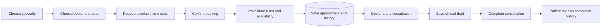

  

<h1 align="center">SaludVital</h1>

  <strong>Medical appointments, clinical workflows, and administration in one application.</strong>
   
  An individual software development graduation project for SENA's ADSO program.

  
  
  
  
  

  

  <a href="#features-by-role">Features</a> ·
  <a href="#technology-stack">Technology Stack</a>

## Overview

SaludVital is a server-rendered web application that brings patient scheduling, doctor consultations, and administrative operations into a shared system. It addresses the need to coordinate medical availability, keep appointment changes traceable, and give each user access to the information relevant to their role.

The project was developed individually as a graduation project for **Tecnología en Análisis y Desarrollo de Software (ADSO)** at **Servicio Nacional de Aprendizaje (SENA), Colombia**. It applies requirements analysis, relational database design, backend and frontend development, automated testing, and version control within a healthcare scheduling scenario.

The application interface is in **Spanish**. Source identifiers and this technical overview are in **English**.

**Current status:** the repository contains implemented patient, doctor, and administrator modules. Local setup instructions will be added in the documentation follow-up. A public demonstration URL has not been published; external messaging requires provider configuration.

## Features by Role

All three roles use the same login form. The server reads the account's role from the database, selects its dashboard, and enforces authorization on protected routes.

| Role              | Implemented capabilities                                                                                                                                                                                                                                                                                                                     |
| ----------------- | -------------------------------------------------------------------------------------------------------------------------------------------------------------------------------------------------------------------------------------------------------------------------------------------------------------------------------------------- |
| **Patient**       | Register and verify an email address; book, view, reschedule, and cancel appointments; review completed consultations, diagnoses, and treatments; manage profile information, photos, and notification channels.                                                                                                                             |
| **Doctor**        | Review assigned appointments and daily, weekly, and monthly agenda views; start a consultation; save clinical drafts; record symptoms, vital signs, diagnoses, prescriptions, recommendations, and medical orders; complete consultations; review authorized patient history and appointment notifications; update permitted profile fields. |
| **Administrator** | Manage user access, doctor accounts, specialties, appointments, weekly availability, and schedule exceptions; review appointment impacts; export appointment records; inspect audit events, reports, notification history, and WhatsApp activity; manage administrative profile settings.                                                    |

### Appointment Workflow

Scheduling rules in the patient service include:

- **30-minute appointment slots**, with new bookings made at least 30 minutes in advance.
- Up to **two non-cancelled appointments per patient per Bogotá calendar day**, in different specialties.
- Checks for overlapping appointments for both the doctor and patient.
- Weekly availability, additional availability, and blocking schedule exceptions.
- Patient cancellation at least **24 hours before** the appointment.
- Patient rescheduling at least **24 hours before the original appointment**, with a new slot at least **five hours ahead**, subject to a maximum of three patient reschedules. Administrative workflows have different notice rules.
- Pediatric eligibility checks for patients under 18 on the appointment date.
- Automatic transition of appointments that remain confirmed one hour after their scheduled start to **No Show**, with history and audit records.

Booking operations use database transactions and row locks to coordinate concurrent requests. Availability displayed in the browser is checked again before persistence.

Implementation: [appointmentService.js](src/modules/patient/services/appointmentService.js), [doctorConsultationService.js](src/modules/doctor/services/doctorConsultationService.js), and [noShowAppointmentService.js](src/modules/admin/services/noShowAppointmentService.js).

## Technology Stack

| Layer                     | Technology                                          | How it is used                                                                         |
| ------------------------- | --------------------------------------------------- | -------------------------------------------------------------------------------------- |
| Language                  | JavaScript, ES modules                              | Application logic on the server and in the browser.                                    |
| Runtime and HTTP          | Node.js, Express 5                                  | Server startup, request processing, routing, middleware, and error handling.           |
| Templates                 | Pug                                                 | Server-rendered HTML pages and shared interface partials.                              |
| Styling                   | Tailwind CSS 4, custom CSS                          | Responsive layouts, application colors, and interface components.                      |
| Persistence               | MySQL, mysql2                                       | Relational storage and the database driver used by Sequelize.                          |
| Data access               | Sequelize 6, Sequelize CLI                          | Models, associations, transactions, migrations, and seeders.                           |
| Authentication            | bcrypt, jsonwebtoken, cookie-parser                 | Password hashing and verification, signed JWT cookies, and cookie parsing.             |
| Request protection        | Helmet, express-rate-limit                          | Security headers and request throttling.                                               |
| Account email             | Nodemailer, SMTP                                    | Asynchronous email verification and password recovery through an outbox.               |
| Messaging                 | Meta WhatsApp Cloud API, Resend, Inalambria Express | Provider adapters for WhatsApp, notification email, identity codes, and Colombian SMS. |
| Automated tests           | Jest, Supertest                                     | Unit tests, HTTP integration tests, and database integration tests.                    |
| Browser and accessibility | Playwright, @axe-core/playwright                    | Browser workflows, viewport checks, and automated accessibility checks.                |
| Code quality              | ESLint, Prettier                                    | JavaScript checks and consistent formatting.                                           |
| Delivery workflow         | Git, GitHub, GitHub Actions                         | Branches, issues, pull requests, and continuous integration.                           |

Dependency ranges and commands are defined in [package.json](package.json); resolved dependencies are recorded in [package-lock.json](package-lock.json).

## Academic Context and Authorship

| Item             | Description                                                                                         |
| ---------------- | --------------------------------------------------------------------------------------------------- |
| Institution      | Servicio Nacional de Aprendizaje — SENA, Colombia                                                   |
| Program          | Tecnología en Análisis y Desarrollo de Software — ADSO                                              |
| Project type     | Individual graduation project                                                                       |
| Focus            | Analysis, design, implementation, testing, and documentation of a healthcare scheduling application |
| Repository owner | [personalProjectsDeltaG8109](https://github.com/personalProjectsDeltaG8109)                         |

## License

`package.json` declares `ISC`. A standalone license file is not currently included in the repository.
