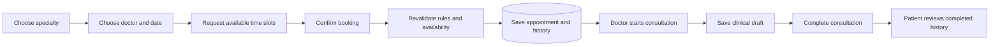
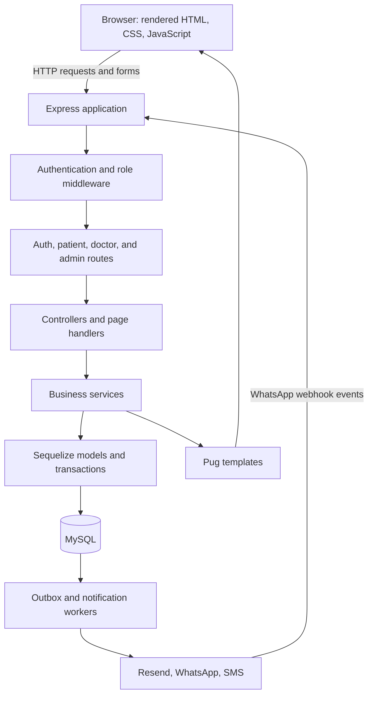
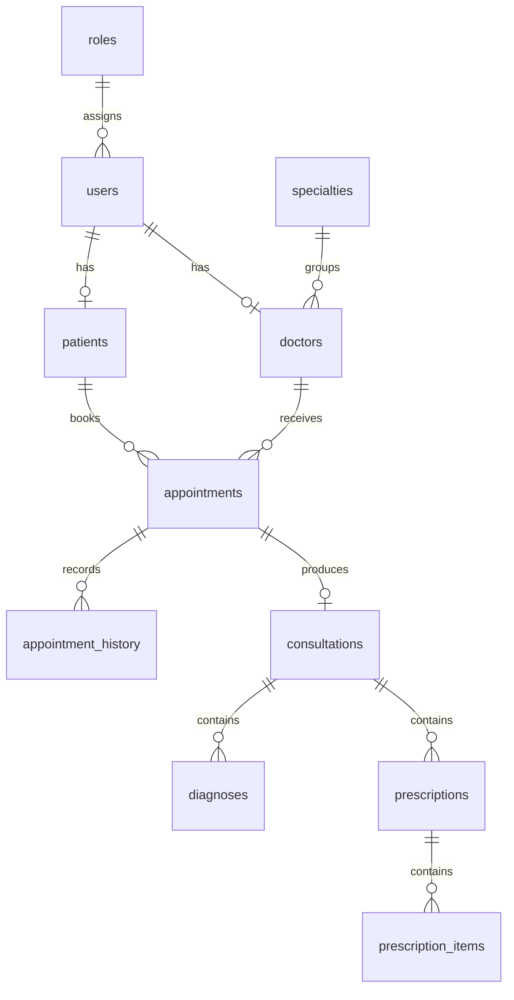

<p align="center">
  
</p>

<h1 align="center">SaludVital</h1>

<p align="center">
  <strong>Medical appointments, clinical workflows, and administration in one application.</strong>
  <br />
  An individual software development graduation project for SENA's ADSO program.
</p>

<p align="center">
  
  
  
  
  
</p>

<p align="center">
  <a href="https://github.com/personalProjectsDeltaG8109/saludvital/actions/workflows/ci.yml"></a>
</p>

<p align="center">
  <a href="#features-by-role">Features</a> ·
  <a href="#technology-stack">Technology Stack</a> ·
  <a href="#architecture">Architecture</a> ·
  <a href="#getting-started">Getting Started</a> ·
  <a href="#testing-and-quality">Testing</a> ·
  <a href="#documentation">Documentation</a>
</p>

## Overview

SaludVital is a server-rendered web application that brings patient scheduling, doctor consultations, and administrative operations into a shared system. It addresses the need to coordinate medical availability, keep appointment changes traceable, and give each user access to the information relevant to their role.

The project was developed individually as a graduation project for **Tecnología en Análisis y Desarrollo de Software (ADSO)** at **Servicio Nacional de Aprendizaje (SENA), Colombia**. It applies requirements analysis, relational database design, backend and frontend development, automated testing, and version control within a healthcare scheduling scenario.

The application interface is in **Spanish**. Source identifiers and this technical overview are in **English**.

**Current status:** the repository contains implemented patient, doctor, and administrator modules. Local execution is documented below. A public demonstration URL has not been published; external messaging requires provider configuration. See [Current Limitations](#current-limitations) for deployment and integration boundaries.

## Features by Role

All three roles use the same login form. The server reads the account's role from the database, selects its dashboard, and enforces authorization on protected routes.

| Role              | Implemented capabilities                                                                                                                                                                                                                                                                                                                     |
| ----------------- | -------------------------------------------------------------------------------------------------------------------------------------------------------------------------------------------------------------------------------------------------------------------------------------------------------------------------------------------- |
| **Patient**       | Register and verify an email address; book, view, reschedule, and cancel appointments; review completed consultations, diagnoses, and treatments; manage profile information, photos, and notification channels.                                                                                                                             |
| **Doctor**        | Review assigned appointments and daily, weekly, and monthly agenda views; start a consultation; save clinical drafts; record symptoms, vital signs, diagnoses, prescriptions, recommendations, and medical orders; complete consultations; review authorized patient history and appointment notifications; update permitted profile fields. |
| **Administrator** | Manage user access, doctor accounts, specialties, appointments, weekly availability, and schedule exceptions; review appointment impacts; export appointment records; inspect audit events, reports, notification history, and WhatsApp activity; manage administrative profile settings.                                                    |

### Appointment Workflow



Scheduling rules in the patient service include:

- **30-minute appointment slots**, with new bookings made at least 30 minutes in advance.
- Up to **two non-cancelled appointments per patient per Bogotá calendar day**, in different specialties.
- Checks for overlapping appointments for both the doctor and patient.
- Weekly availability, additional availability, and blocking schedule exceptions.
- Patient cancellation at least **24 hours before** the appointment.
- Patient rescheduling at least **24 hours before the original appointment**, with a new slot at least **five hours ahead**, subject to a maximum of three patient reschedules. Administrative workflows have different notice rules.
- Pediatric eligibility checks for patients under 18 on the appointment date.
- Automatic transition of appointments that remain confirmed one hour after their scheduled start to **No Show**, with history and audit records.

Booking operations use database transactions and row locks to coordinate concurrent requests. Availability displayed in the browser is checked again before persistence.

Implementation: [appointmentService.js](src/modules/patient/services/appointmentService.js), [doctorConsultationService.js](src/modules/doctor/services/doctorConsultationService.js), and [noShowAppointmentService.js](src/modules/admin/services/noShowAppointmentService.js).

## Technology Stack

| Layer                     | Technology                                          | How it is used                                                                         |
| ------------------------- | --------------------------------------------------- | -------------------------------------------------------------------------------------- |
| Language                  | JavaScript, ES modules                              | Application logic on the server and in the browser.                                    |
| Runtime and HTTP          | Node.js, Express 5                                  | Server startup, request processing, routing, middleware, and error handling.           |
| Templates                 | Pug                                                 | Server-rendered HTML pages and shared interface partials.                              |
| Styling                   | Tailwind CSS 4, custom CSS                          | Responsive layouts, application colors, and interface components.                      |
| Persistence               | MySQL, mysql2                                       | Relational storage and the database driver used by Sequelize.                          |
| Data access               | Sequelize 6, Sequelize CLI                          | Models, associations, transactions, migrations, and seeders.                           |
| Authentication            | bcrypt, jsonwebtoken, cookie-parser                 | Password hashing and verification, signed JWT cookies, and cookie parsing.             |
| Request protection        | Helmet, express-rate-limit                          | Security headers and request throttling.                                               |
| Account email             | Resend API                                           | Asynchronous email verification and password recovery through an outbox.               |
| Messaging                 | Meta WhatsApp Cloud API, Resend, Inalambria Express | Provider adapters for WhatsApp, notification email, identity codes, and Colombian SMS. |
| Automated tests           | Jest, Supertest                                     | Unit tests, HTTP integration tests, and database integration tests.                    |
| Browser and accessibility | Playwright, @axe-core/playwright                    | Browser workflows, viewport checks, and automated accessibility checks.                |
| Code quality              | ESLint, Prettier                                    | JavaScript checks and consistent formatting.                                           |
| Delivery workflow         | Git, GitHub, GitHub Actions                         | Branches, issues, pull requests, and continuous integration.                           |

Dependency ranges and commands are defined in [package.json](package.json); resolved dependencies are recorded in [package-lock.json](package-lock.json).

## Architecture

SaludVital runs as a **single Express application organized into feature modules**. Pug renders pages on the server, while browser scripts call JSON endpoints for interactive workflows. Routes delegate business operations to services; some page handlers also query models directly.



- [app.js](app.js) configures middleware, static assets, templates, routes, and error handling.
- [server.js](server.js) verifies the database connection, starts the HTTP server and background schedulers, and coordinates shutdown.
- [src/modules](src/modules) contains the `auth`, `patient`, `doctor`, and `admin` domains.
- [src/models/associations.js](src/models/associations.js) registers the relationships used by Sequelize queries.

### Core Data Relationships



This is a simplified relationship diagram. Additional tables support availability, exceptions, notification preferences, message delivery, email jobs, password recovery, WhatsApp conversations, and audit logs. Schema changes are versioned in [database/migrations](database/migrations).

## Authentication and Security

- Passwords are stored as bcrypt hashes; login uses `bcrypt.compare`.
- A signed **HS256 JWT** is stored in an `httpOnly` cookie with `sameSite: lax`; the cookie is `secure` in production.
- A server-side session identifier links the JWT to an in-memory activity record. The inactivity limit is three minutes; JWT expiry is configured separately.
- Protected requests check the account's current active state and role before applying role authorization.
- Login has both request throttling and a persistent account lock after five failed password attempts.
- Email verification and password recovery use expiring tokens whose hashes are persisted.
- Business services validate inputs and ownership; relevant operations create appointment history or audit records.

These are implemented controls, not a security certification. Deployment-related limitations and remaining work are listed below. Never commit `.env`, signing secrets, provider keys, or real patient information.

## Notifications and WhatsApp

| Component                     | Implementation and requirements                                                                                                                                                                                                                               |
| ----------------------------- | ------------------------------------------------------------------------------------------------------------------------------------------------------------------------------------------------------------------------------------------------------------- |
| **Account email**             | `EmailOutbox` jobs are processed through the Resend API for verification and recovery. Requires a verified sender and a correct `APP_BASE_URL`.                                                                                                               |
| **Appointment notifications** | Workers process reminders, rescheduling, and cancellation events using patient channel preferences. Delivery remains disabled unless `NOTIFICATION_DELIVERY_ENABLED=true`.                                                                                    |
| **Email notifications**       | Resend adapter with configurable sender and message content.                                                                                                                                                                                                  |
| **SMS**                       | Inalambria Express adapter for Colombian mobile numbers, with error classification for retry decisions.                                                                                                                                                       |
| **WhatsApp**                  | Meta message adapters, signed webhook validation, conversation/message persistence, and provider delivery-status updates. Requires Meta credentials, webhook setup, and approved notification templates.                                                      |
| **Chatbot**                   | Code supports patient identity verification and appointment operations. Execution requires a published active flow and is explicitly disabled when `NODE_ENV=production`. The administrative editor saves draft versions; saving a draft does not publish it. |

Provider acceptance, delivery, and reading are different events. A configured key or template name does not prove successful delivery or provider approval. External delivery must be verified separately in the intended environment.

## Getting Started

### Requirements

- **Node.js 24** and npm, matching the CI runtime.
- A reachable **MySQL server**; CI uses MySQL 8.4.
- Git.
- A Resend API key and verified sender if you want to exercise registration verification or password recovery by email.

### 1. Install the Application

```bash
git clone --branch develop https://github.com/personalProjectsDeltaG8109/saludvital.git
cd saludvital
npm ci
```

The example checks out `develop`, the integration branch. See [CONTRIBUTING.md](CONTRIBUTING.md) for branch and review conventions.

### 2. Configure the Environment

Copy [.env.example](.env.example) to `.env`:

```powershell
# Windows PowerShell
Copy-Item .env.example .env
```

```bash
# macOS / Linux
cp .env.example .env
```

Set these values for your local environment:

| Variables                                                            | Purpose                                                                     |
| -------------------------------------------------------------------- | --------------------------------------------------------------------------- |
| `NODE_ENV`, `PORT`                                                   | Execution mode and HTTP port. Use `development` locally.                    |
| `DB_HOST`, `DB_PORT`, `DB_NAME`, `DB_USER`, `DB_PASSWORD`            | Connection to your local development database.                              |
| `JWT_SECRET`, `JWT_EXPIRES_IN`                                       | A generated signing secret and token lifetime.                              |
| `APP_BASE_URL`                                                       | Public or local base address used in account email links.                   |
| `RESEND_API_KEY`, `RESEND_FROM_EMAIL`, `RESEND_FROM_NAME` | Resend settings for account email and email notifications.                    |
| `NOTIFICATION_DELIVERY_ENABLED`                                      | Leave `false` until messaging providers and test recipients are configured. |

Additional provider variables are documented in `.env.example`. Replace example values locally; do not commit the resulting file.

### 3. Prepare a Local Development Database

Create the database named by `DB_NAME` on your MySQL server and grant your configured database user access. Then apply the schema:

```bash
npm run db:migrate
```

For a fresh, isolated **development** database, populate the initial roles, appointment statuses, and demonstration environment:

```bash
npm run db:seed
```

The consolidated demo seeder creates fictional patient, doctor, and administrator accounts; appointments in confirmed, rescheduled, cancelled, no-show, and attended states; completed consultations and diagnoses; sample notification history; and administrator audit activity. Appointment dates are recalculated from the current date in Colombia, and the fixture records are refreshed without duplicating them when the seeder is run again. The older development seeder filenames remain as no-op compatibility entries for databases that already recorded them.

Use these local-only credentials for all seeded accounts:

| Role          | Email                                      | Password              |
| ------------- | ------------------------------------------ | --------------------- |
| Patient       | `test@saludvital.local`                    | `SaludVitalTest2026!` |
| Doctor        | `doctor.test@saludvital.local`             | `SaludVitalTest2026!` |
| Doctor        | `doctor.pediatrics.test@saludvital.local`  | `SaludVitalTest2026!` |
| Doctor        | `doctor.dermatology.test@saludvital.local` | `SaludVitalTest2026!` |
| Administrator | `admin.test@saludvital.local`              | `SaludVitalTest2026!` |

Every clinical value and notification is marked as demonstration data; the seeder does not send messages to email, SMS, or WhatsApp providers. It refuses to run when `NODE_ENV=production`. Run it only against an isolated local development database, never against a database containing real patient data.

### 4. Build Styles and Run

```bash
npm run css:build
npm run dev
```

Open **http://localhost:3000/login**, or use the port configured in `.env`. Use the local development accounts defined by the seeders or register a patient and complete email verification. `npm start` runs the server without Nodemon.

## Testing and Quality

| Command                              | Purpose                                                            |
| ------------------------------------ | ------------------------------------------------------------------ |
| `npm test -- --runInBand tests/unit` | Run unit tests serially.                                           |
| `npm run db:test:prepare`            | Apply migrations and initial roles to the dedicated test database. |
| `npm test -- --runInBand`            | Run Jest unit and integration tests.                               |
| `npm run test:coverage`              | Generate a coverage report.                                        |
| `npx playwright install chromium`    | Install the Chromium browser used by browser tests.                |
| `npm run test:e2e`                   | Run the repository's Playwright scripts.                           |
| `npm run lint`                       | Check JavaScript with ESLint.                                      |
| `npm run format:check`               | Check formatting with Prettier.                                    |
| `npm run css:build`                  | Compile the Tailwind stylesheet.                                   |

Create **`saludvital_test`** and grant access to the configured database user before preparing database tests. The Jest setup selects that database explicitly; integration and browser tests can create, update, and remove test records. Keep it separate from development and production data.

The [GitHub Actions workflow](.github/workflows/ci.yml) provisions MySQL 8.4, uses Node.js 24, installs locked dependencies, and runs ESLint, database preparation, Jest, targeted formatting checks, CSS compilation, and browser/accessibility tests. It runs for configured pushes and pull requests involving `main`, `develop`, and `release/**`.

Test counts and coverage are intentionally not hard-coded here. Check [workflow runs](https://github.com/personalProjectsDeltaG8109/saludvital/actions/workflows/ci.yml) and generated reports for current results. Automated axe-core checks complement manual accessibility review; they do not establish full accessibility conformance.

## Project Structure

```text
saludvital/
├── app.js                  Express configuration and route registration
├── server.js               HTTP startup, schedulers, and shutdown
├── config/                 Environment, database, and CLI configuration
├── database/
│   ├── migrations/         Versioned schema changes
│   └── seeders/            Initial records and development fixtures
├── src/
│   ├── middleware/         Authentication, authorization, error handling
│   ├── models/             Sequelize models and associations
│   ├── modules/
│   │   ├── auth/           Registration, login, recovery, email jobs
│   │   ├── patient/        Appointments, profile, history, messaging
│   │   ├── doctor/         Agenda, consultations, patient access
│   │   └── admin/          Administration, reports, audit, monitoring
│   ├── config/             Shared scheduling configuration
│   └── styles/             Editable Tailwind and CSS source
├── views/                  Pug pages and partials by role
├── public/                 Stylesheets, browser scripts, brand assets
├── scripts/                Database preparation and provider diagnostics
├── tests/                  Unit, integration, and browser tests
├── docs/                   User stories and implementation notes
└── .github/                CI workflow and issue/PR templates
```

## Current Limitations

- **Public demo:** hosting and a demonstration URL are pending.
- **Sessions:** activity records are process-local and disappear on restart. Multi-instance deployment needs shared session state. The logout route currently clears the cookie without first resolving `req.auth`, so immediate server-side revocation needs completion.
- **Uploads:** profile photos use the local filesystem; deployment needs a persistence strategy.
- **Messaging:** credentials, sender setup, templates, recipient permissions, and delivery checks are environment-dependent. No live provider availability is asserted here.
- **Chatbot administration:** draft editing and runtime execution have different lifecycle requirements; production chatbot execution is currently disabled.
- **Clinical documents:** completed clinical information and medical orders are supported, but a consultation-document attachment module is not implemented.

## Documentation

- [User Stories and Acceptance Criteria](docs/userStories/userStories.md)
- [Implementation Notes](docs/implementation)
- [Models and Relationships](src/models/associations.js)
- [Database Migrations](database/migrations)
- [Environment Reference](.env.example)
- [Development and Contribution Workflow](CONTRIBUTING.md)
- [Issues](https://github.com/personalProjectsDeltaG8109/saludvital/issues)

## Academic Context and Authorship

| Item             | Description                                                                                         |
| ---------------- | --------------------------------------------------------------------------------------------------- |
| Institution      | Servicio Nacional de Aprendizaje — SENA, Colombia                                                   |
| Program          | Tecnología en Análisis y Desarrollo de Software — ADSO                                              |
| Project type     | Individual graduation project                                                                       |
| Focus            | Analysis, design, implementation, testing, and documentation of a healthcare scheduling application |
| Repository owner | [personalProjectsDeltaG8109](https://github.com/personalProjectsDeltaG8109)                         |

## License

`package.json` declares `ISC`. A standalone license file is not currently included in the repository.
