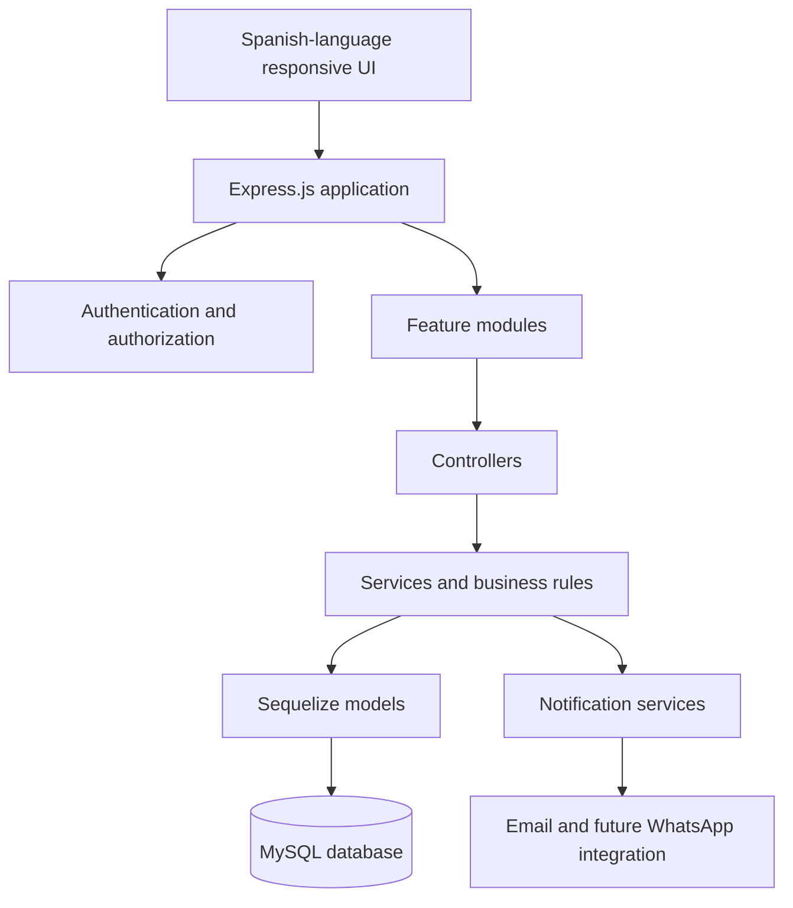
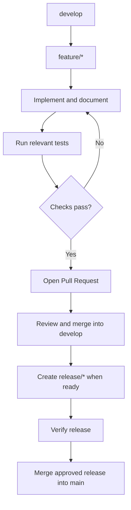

# SaludVital

<p align="center">
  
</p>

<h3 align="center">Your health. Connected.</h3>

<p align="center">
  A modern, accessible, and responsive medical appointment management platform.
  <br />
  Connecting patients, healthcare professionals, and administrators through a unified digital experience.
</p>

<p align="center">
  
  
  
  
</p>

<p align="center">
  <a href="https://github.com/personalProjectsDeltaG8109/saludvital/issues">Report an Issue</a>
  ·
  <a href="https://github.com/personalProjectsDeltaG8109/saludvital/wiki">Project Wiki</a>
  ·
  <a href="https://github.com/personalProjectsDeltaG8109/saludvital/projects">Project Board</a>
</p>

---

## Table of Contents

- [About the Project](#about-the-project)
- [Vision and Goals](#vision-and-goals)
- [Key Features](#key-features)
- [User Roles](#user-roles)
- [Technology Stack](#technology-stack)
- [Architecture](#architecture)
- [Project Structure](#project-structure)
- [Database Design](#database-design)
- [Accessibility and Responsive Design](#accessibility-and-responsive-design)
- [Security and Privacy](#security-and-privacy)
- [Testing Strategy](#testing-strategy)
- [Development Workflow](#development-workflow)
- [Project Management](#project-management)
- [Getting Started](#getting-started)
- [Documentation](#documentation)
- [Roadmap](#roadmap)
- [Contributing](#contributing)
- [License](#license)

## About the Project

**SaludVital** is a healthcare appointment management system designed to simplify the interaction between patients, doctors, and administrative staff.

The platform aims to make appointment scheduling more accessible, improve healthcare workflow organization, and provide authorized users with the tools they need to manage appointments and related medical information.

The application will provide a Spanish-language user experience while maintaining English naming conventions throughout the source code, database schema, technical documentation, and development workflow.

> **Project status:** Planning and initial repository setup. Features described in this README represent the planned product scope and will be implemented and verified incrementally.

## Vision and Goals

Our vision is to build a reliable, intuitive, and inclusive digital platform that makes healthcare appointment management easier for everyone.

### Project Goals

- Simplify the medical appointment scheduling process.
- Improve coordination between patients and healthcare professionals.
- Provide role-based access to appropriate functionality.
- Organize appointment schedules and availability.
- Support the management of diagnoses and prescriptions by authorized medical professionals.
- Reduce missed appointments through configurable notifications.
- Explore appointment requests and notifications through WhatsApp.
- Deliver a consistent experience across mobile devices, tablets, and desktop computers.
- Apply accessibility, privacy, and security principles throughout development.

## Key Features

Features will be delivered incrementally through planned development sprints.

### Patient Portal

- Account registration and authentication.
- Patient profile management.
- Doctor and specialty discovery.
- Appointment booking, cancellation, and rescheduling.
- Appointment history and status tracking.
- Access to authorized medical information.
- Notification preferences.
- Planned WhatsApp appointment request workflow.

### Doctor Portal

- Appointment calendar and daily schedule.
- Availability and schedule management.
- Access to assigned appointments.
- Authorized patient information.
- Diagnosis recording during medical consultations.
- Prescription creation and management.
- Access to authorized clinical history.

### Administrator Portal

- User and role administration.
- Doctor and specialty management.
- Appointment oversight.
- Schedule and availability administration.
- Consultation of diagnoses and prescriptions according to permissions.
- Administrative dashboard and operational indicators.
- Notification configuration and audit monitoring.

**Clinical responsibility:** Diagnoses and prescriptions are created and managed by authorized healthcare professionals. Administrative access does not automatically grant permission to create or modify clinical records.

## User Roles

| Role          | Main responsibilities                                                |
| ------------- | -------------------------------------------------------------------- |
| Patient       | Manage personal information and medical appointments.                |
| Doctor        | Manage assigned appointments and authorized clinical records.        |
| Administrator | Manage platform configuration, users, and administrative operations. |

Access to protected resources will be enforced on the server through authentication, authorization, and validation rules.

## Technology Stack

The following technologies are the initial architectural proposal. Versions and dependencies will be selected and verified during project setup.

| Technology     | Purpose                                                          |
| -------------- | ---------------------------------------------------------------- |
| JavaScript     | Primary programming language.                                    |
| Node.js        | Server-side JavaScript runtime.                                  |
| Express.js     | HTTP server, routing, and middleware.                            |
| Pug            | Server-rendered HTML templates.                                  |
| HTML5          | Semantic page structure.                                         |
| Tailwind CSS   | Responsive interface styling and reusable design patterns.       |
| MySQL          | Relational database.                                             |
| Sequelize      | Object-relational mapping and database access.                   |
| Jest           | Unit and integration testing.                                    |
| Supertest      | HTTP endpoint testing.                                           |
| Playwright     | Browser automation and end-to-end testing.                       |
| axe-core       | Automated accessibility checks.                                  |
| Git and GitHub | Version control, collaboration, reviews, and project management. |

### Architectural Principles

- Modular and maintainable code.
- Separation of presentation, business logic, and data access.
- Reusable interface components.
- Consistent naming conventions in English.
- Centralized configuration and environment variables.
- Automated testing from the beginning.
- Responsive and accessible interface design.

## Architecture

SaludVital will initially follow a modular monolithic architecture.



The application will be organized into modules such as authentication, patients, doctors, appointments, schedules, diagnoses, prescriptions, notifications, and administration.

Each module will separate routing, request handling, business rules, and validation wherever appropriate.

## Project Structure

The following structure is the intended direction. Directories will be introduced as the corresponding functionality is implemented.

```text
saludvital/
├── app.js
├── server.js
├── package.json
├── .env.example
├── .gitignore
├── README.md
├── config/
│   ├── database.js
│   └── environment.js
├── database/
│   ├── migrations/
│   └── seeders/
├── src/
│   ├── modules/
│   │   ├── auth/
│   │   ├── patients/
│   │   ├── doctors/
│   │   ├── appointments/
│   │   ├── schedules/
│   │   ├── diagnoses/
│   │   ├── prescriptions/
│   │   ├── specialties/
│   │   ├── notifications/
│   │   └── administration/
│   ├── middleware/
│   ├── models/
│   ├── services/
│   └── utils/
├── views/
│   ├── layouts/
│   ├── components/
│   └── pages/
│       ├── auth/
│       ├── patient/
│       ├── doctor/
│       └── admin/
├── public/
│   ├── css/
│   ├── js/
│   ├── images/
│   └── icons/
├── tests/
│   ├── unit/
│   ├── integration/
│   ├── accessibility/
│   └── e2e/
├── docs/
│   ├── assets/
│   ├── diagrams/
│   └── technical/
└── .github/
    ├── ISSUE_TEMPLATE/
    └── PULL_REQUEST_TEMPLATE.md
```

## Database Design

The application will use MySQL with Sequelize for structured data management.

The database design will be documented before implementing the business modules.

Planned entities include:

- Users and roles.
- Patients and doctors.
- Medical specialties.
- Doctor schedules and schedule exceptions.
- Appointments and appointment statuses.
- Diagnoses and prescriptions.
- Notifications and notification preferences.
- WhatsApp appointment requests.
- Audit logs.

The final schema, entity relationships, field definitions, constraints, indexes, migrations, and seed data will be documented in the project Wiki.

Database names, table names, column names, and model identifiers will use English conventions.

## Accessibility and Responsive Design

SaludVital will be designed for a broad range of users and devices.

### Responsive Design

Target testing widths:

| Device category | Reference width |
| --------------- | --------------: |
| Small mobile    |          320 px |
| Standard mobile |          375 px |
| Large mobile    |          430 px |
| Tablet          |          768 px |
| Laptop          |         1024 px |
| Desktop         |         1440 px |

These widths are testing references, not fixed layout restrictions.

### Accessibility Goals

- Target WCAG 2.2 Level AA.
- Keyboard-accessible navigation and controls.
- Visible focus indicators.
- Appropriate text and interface contrast.
- Semantic HTML and accessible form labels.
- Clear validation and error messages in Spanish.
- Screen-reader support.
- Adequate touch target sizes.
- No reliance on color alone to communicate information.
- Testing at different zoom levels and viewport sizes.

Automated accessibility tools will complement manual keyboard and screen-reader checks.

## Security and Privacy

Security will be incorporated into the architecture and development workflow.

Planned measures include:

- Secure password hashing.
- Server-side input validation.
- Role-based authorization.
- Secure session and cookie configuration.
- Protection against common web vulnerabilities.
- Environment-based secret management.
- Restricted access to clinical information.
- Audit logging for relevant actions.
- Safe error handling that avoids exposing sensitive information.
- Synthetic data for development and testing.

Security and privacy requirements will be reviewed against the applicable regulations before production deployment.

## Testing Strategy

Testing will be introduced alongside implementation, rather than postponed until the end.

| Test level          | Purpose                                          | Proposed tools             |
| ------------------- | ------------------------------------------------ | -------------------------- |
| Unit tests          | Validate individual functions and services.      | Jest                       |
| Integration tests   | Validate module and database interactions.       | Jest, Supertest            |
| End-to-end tests    | Verify complete user workflows.                  | Playwright                 |
| Responsive tests    | Check layouts across viewport sizes.             | Playwright                 |
| Accessibility tests | Detect accessibility violations.                 | axe-core and manual checks |
| Regression tests    | Ensure existing functionality continues working. | Automated test suite       |

A feature will not be considered complete until its acceptance criteria and relevant tests have been reviewed.

## Development Workflow

The project will use a controlled branch-based workflow.



### Branch Conventions

| Branch      | Purpose                                                  |
| ----------- | -------------------------------------------------------- |
| `main`      | Production-ready code.                                   |
| `develop`   | Integration branch for completed features.               |
| `release/*` | Release preparation, stabilization, and verification.    |
| `feature/*` | New functionality, documentation, and development tasks. |

Development work must not be performed directly on `main` or `develop`.

### Commit Conventions

Commit messages will use English and follow a consistent format.

Examples:

```text
docs: initialize project documentation
feat: add patient registration form
test: add appointment validation tests
fix: correct mobile navigation layout
refactor: separate appointment business logic
```

Pull Requests will reference related Issues, describe the changes, and include relevant testing evidence.

## Project Management

GitHub will be used to manage development tasks, collaboration, and sprint progress.

The project will include:

- **Issues:** user stories, bugs, technical tasks, and testing tasks.
- **Labels:** type, priority, module, and review status.
- **Assignees:** an identified person responsible for each task.
- **Milestones:** sprint goals and release objectives.
- **GitHub Projects:** the development board and progress tracking.
- **GitHub Wiki:** technical documentation and project decisions.

## Getting Started

### Prerequisites

- Node.js 24.x
- npm (included with Node.js)
- Git
- MariaDB 10.4 or a compatible MySQL server
- Visual Studio Code or another JavaScript editor

The project uses Sequelize 6 with the `mysql2` driver. The current local development environment uses MariaDB through Sequelize's `mysql` dialect.

### Installation

Clone the repository and enter the project directory:

```bash
git clone https://github.com/personalProjectsDeltaG8109/saludvital.git
cd saludvital
npm install
```

### Environment Configuration

Create a local `.env` file by copying `.env.example`:

```bash
cp .env.example .env
```

Update the database settings in `.env` to match your local database server. Never commit `.env` or put real credentials in `.env.example`.

Required database variables:

- `DB_HOST`: database server hostname.
- `DB_PORT`: database server port.
- `DB_NAME`: application database name.
- `DB_USER`: database username.
- `DB_PASSWORD`: database password, if configured.

The application also uses `NODE_ENV`, `PORT`, `JWT_SECRET`, and `JWT_EXPIRES_IN`. Set a secure random `JWT_SECRET` before using the application outside local development.

### Development

Start the development server with automatic restarts:

```bash
npm run dev
```

The default local address is `http://localhost:3000`.

The health endpoint is available at `/health`.

### CSS Compilation

Compile Tailwind CSS locally:

```bash
npm run css:build
```

To watch for stylesheet changes during development:

```bash
npm run css:watch
```

The compiled stylesheet is written to `public/css/app.css`. The application does not load Tailwind CSS from a CDN.

### Database Commands

The project uses Sequelize CLI for database migrations and seeders.

```bash
npm run db:migrate
npm run db:migrate:undo
npm run db:seed
npm run db:seed:undo
```

These commands operate on the database configured through the environment variables. Review migration and seeder files before executing them. No complete application schema or initial business seed data is included in this foundation feature.

### Testing and Code Quality

Run the automated test suite:

```bash
npm test
```

Run tests in watch mode or with coverage:

```bash
npm run test:watch
npm run test:coverage
```

Run ESLint and check formatting:

```bash
npm run lint
npx prettier --check .
```

Verify the database connection using the local diagnostic script:

```bash
node scripts/check-database.js
```

The database check requires a reachable database server and valid local credentials.

### Initial Project Structure

```text
config/                 Application and CLI configuration
database/migrations/    Database migration files
database/seeders/       Database seed files
src/models/             Application data models
src/styles/             Tailwind CSS source
views/                  Pug templates
public/                 Static assets and compiled CSS
tests/unit/             Unit tests
tests/integration/      Integration tests
```

Additional modules, accessibility tests, end-to-end tests, and technical documentation will be added as their corresponding requirements are implemented.

## Documentation

The GitHub Wiki will be the primary source of detailed project documentation.

Planned documentation pages:

- Product Overview.
- Vision and Scope.
- Functional Requirements.
- Non-Functional Requirements.
- User Stories and Acceptance Criteria.
- Software Architecture.
- Database Design and Data Dictionary.
- UML Diagrams.
- UI/UX and Accessibility.
- Git Workflow.
- Testing Strategy.
- Sprint Planning.
- Security and Privacy.
- Deployment Guide.
- Troubleshooting.

Documentation will be written in English. Explanations and learning support provided to Spanish-speaking contributors may be in Spanish.

## Roadmap

| Phase    | Planned outcome                                                      |
| -------- | -------------------------------------------------------------------- |
| Sprint 0 | Product planning, requirements, architecture, and GitHub setup.      |
| Sprint 1 | Project foundation and responsive design system.                     |
| Sprint 2 | Database and authentication.                                         |
| Sprint 3 | Patient portal and appointment booking.                              |
| Sprint 4 | Doctor portal and clinical workflows.                                |
| Sprint 5 | Administrative portal.                                               |
| Sprint 6 | Notifications and WhatsApp integration.                              |
| Sprint 7 | Quality assurance, security, accessibility, and release preparation. |

## Contributing

Contributions will follow the project's documented Git workflow.

Before submitting a contribution:

1. Review the relevant Issue and acceptance criteria.
2. Create a feature branch from the current `develop` branch.
3. Follow the English naming and commenting conventions.
4. Add or update relevant tests.
5. Verify responsive behavior and accessibility where applicable.
6. Submit a Pull Request with a clear description and testing evidence.
7. Address review feedback before merging.

Issue templates and Pull Request templates will be added during repository setup.

## License

No license has been selected yet. Licensing will be decided before public distribution.

---

<p align="center">
  <strong>SaludVital</strong>
  <br />
  Building a more accessible and connected healthcare experience.
</p>
