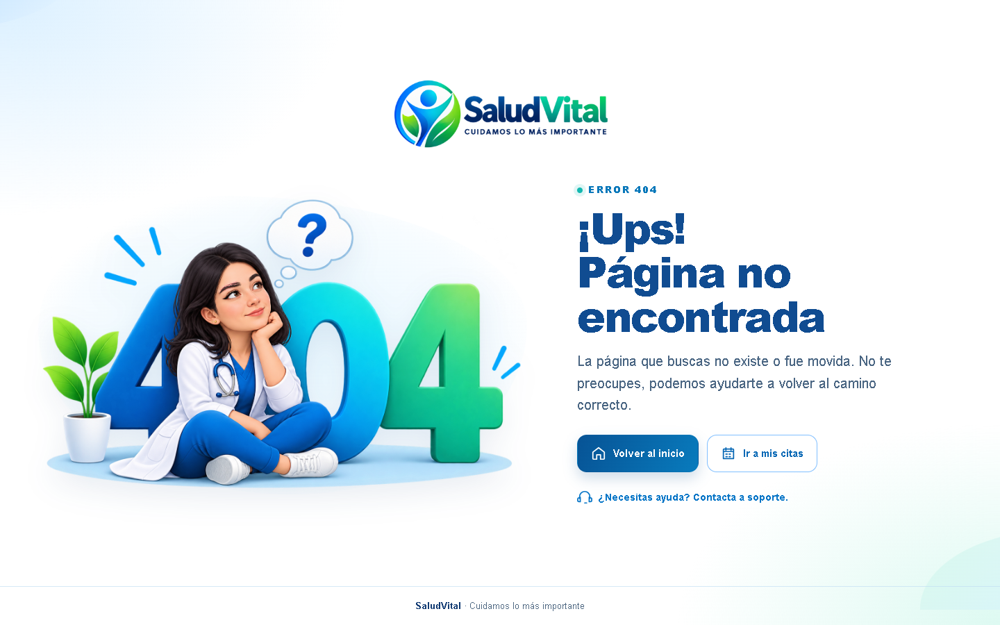
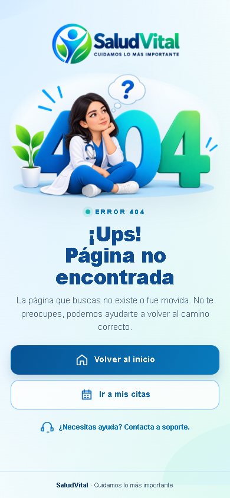

# ISSUE-316 — Replace the Custom 404 Illustration

## Scope

Follow-up to #71. Replace `public/brand/404-medical-illustration.png` with the project owner's supplied `new404.png` image (1605 × 980 pixels).

The existing `views/errors/404.pug` already references this asset path. No template, stylesheet, navigation, authentication, database, or generated Tailwind changes were necessary. The replacement is byte-for-byte identical to the supplied file.

## Browser Review

The real Express application was served on an isolated local port without starting database-dependent background schedulers. Playwright used the installed Chrome browser to inspect an anonymous request to an unknown route.

| Viewport   | HTTP status | Image loaded | Horizontal overflow | axe-core violations |
| ---------- | ----------- | ------------ | ------------------- | ------------------- |
| 1440 × 900 | 404         | Yes          | None                | 0                   |
| 768 × 1024 | 404         | Yes          | None                | 0                   |
| 390 × 844  | 404         | Yes          | None                | 0                   |
| 320 × 740  | 404         | Yes          | None                | 0                   |

The served PNG matched the supplied file's SHA-256 digest. The illustration was visually reviewed in desktop and mobile screenshots before opening the pull request. The anonymous home action navigated successfully to `/login`.

## Screenshots

### Desktop

### Mobile

## Verification

- Focused existing application suite: `npm test -- --runInBand tests/integration/app.test.js --silent` — passed, 1 suite and 77 tests.
- Unknown route returns HTTP 404; static illustration returns HTTP 200.
- Image dimensions and browser loading verified at all four viewports.
- Existing anonymous recovery navigation verified.
- Automated axe-core checks reported no violations in the reviewed pages; this does not establish full accessibility conformance.
- No database migration or provider request was needed.
