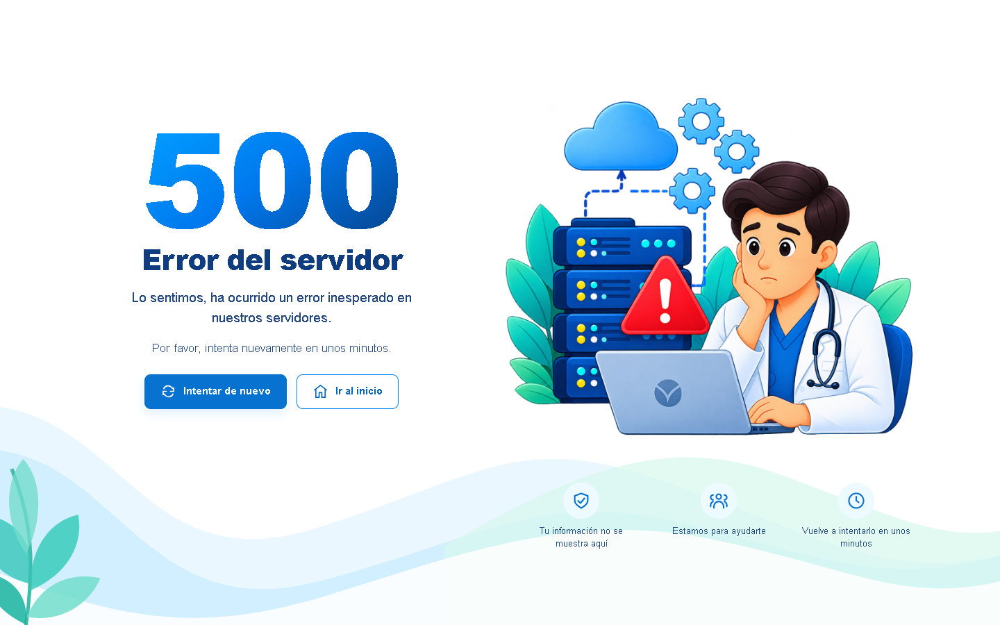
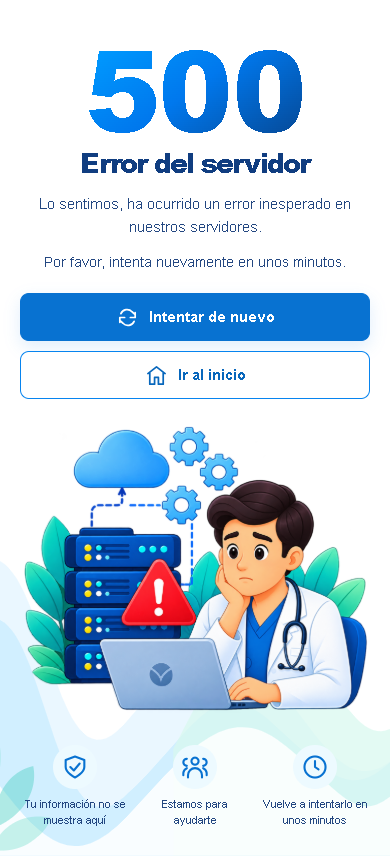

# ISSUE-329 — Responsive Server Error Page

## Scope

Replace the generic 500 card with a branded page based on the project owner's reference: large gradient 500 heading, recovery copy and actions on the left, the supplied medical/server illustration on the right, and blue/teal decorative waves with a lower guidance row.

The supplied PNG is stored unchanged at `public/brand/500-medical-illustration.png` (1377 × 1142). The page uses a dedicated stylesheet instead of the compiled application CSS. Mobile layouts stack the copy, buttons, illustration, and guidance; short desktop viewports have compact spacing and artwork sizing.

## Recovery Behavior

- The centralized error handler continues returning HTTP 500 and displaying generic Spanish copy, without diagnostic details.
- Responses use `Cache-Control: no-store`.
- A retry link performs a fresh GET to a safe same-origin path and retains its escaped query string.
- Failed POST requests offer login recovery instead of repeating a form submission.
- Network-path, external, backslash, and control-character recovery destinations are rejected.
- The home action uses the existing `/` route. No account or database lookup is required to render the error page.
- Recovery links work without JavaScript; keyboard focus has a visible outline.

## Verification

- Focused Jest suites passed: 3 suites, 93 tests, including the new error-handler tests, email-verification error handling, and application HTTP routes.
- Targeted ESLint and Prettier checks passed.
- Browser widths reviewed: 1440, 1280, 768, 390, and 320 pixels. Every preview returned HTTP 500, loaded the illustration, and had no horizontal overflow.
- axe-core reported zero violations at all five reviewed sizes. This is not a complete accessibility certification.
- Browser checks verified keyboard navigation, GET retry recovery, POST-to-login recovery, home navigation, no-JavaScript rendering, and exact source-image integrity.
- Browser preview used an isolated test harness calling the real error middleware. No debug route was added to the production application and no real database records were changed.

## Screenshots

### Desktop

### Mobile

## Publication

Keep this implementation local until the project owner explicitly authorizes publishing the branch and opening a pull request.
