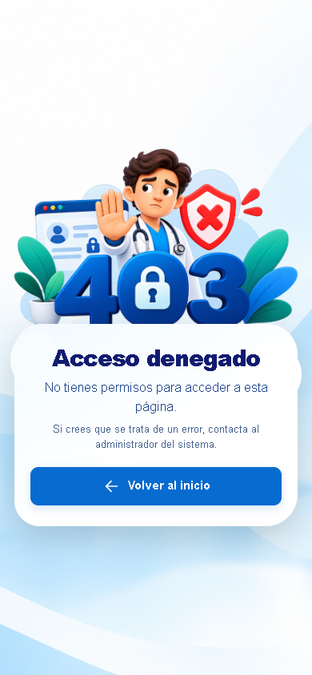

# ISSUE-335 — Responsive Access-Denied Page

## Scope

Implement the supplied 403 reference using the original medical illustration, the shared login background, and a rounded white recovery panel. A single centered home action becomes full-width on mobile. The supplied 1605 × 980 PNG is preserved unchanged.

## Authorization and Recovery

- `requireRole` still rejects unauthorized identities with HTTP 403 and never calls the protected handler.
- HTML navigation renders `views/errors/403.pug` with a dedicated stylesheet and `Cache-Control: no-store`.
- `/api/` requests and non-HTML clients retain the existing plain-text denial response.
- Home recovery uses the existing `/` route.
- The only recovery action is “Volver al inicio”, with a fixed `/` destination independent of identity or request parameters.
- Existing authentication, session validation, and login verification flows are unchanged.

## Verification

- Focused Jest tests: 3 suites passed, 104 tests passed (`accessDenied.http`, `authenticateToken`, and application HTTP routes).
- Targeted ESLint and Prettier checks passed.
- Chrome/Playwright review at 1440 × 900, 1280 × 720, 1280 × 600, 768 × 1024, 390 × 844, and 320 × 740.
- HTTP 403, image loading, no horizontal overflow, recovery destinations, keyboard focus, and no-JavaScript navigation verified.
- axe-core reported no violations at all three updated review sizes; these automated checks do not establish full accessibility conformance.
- The image served by the browser matched the supplied file's SHA-256 digest.
- Preview used an isolated harness with synthetic identities and the real role middleware; no preview routes or authentication shortcuts were added to the application and no real database records were changed.

## Screenshots

### Desktop

### Mobile

## Publication

Keep the branch and commits local until the project owner explicitly authorizes pushing and opening a pull request.
