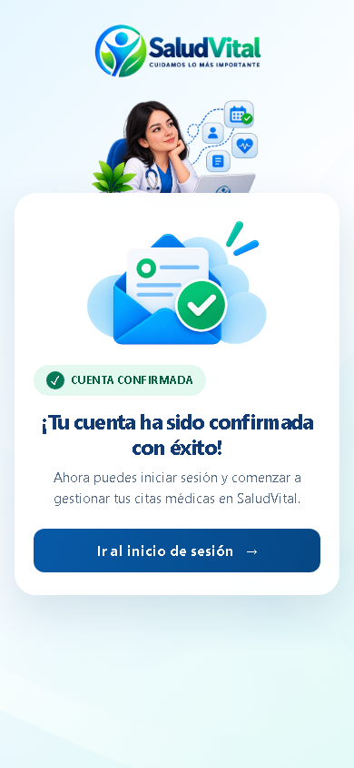

# US-AUTH-13 — Show Account Verification Success

- Issue: [#369 — US-AUTH-13](https://github.com/personalProjectsDeltaG8109/saludvital/issues/369)
- The existing email-verification service and token rules remain unchanged. Successful and unsuccessful outcomes still come from the existing verification endpoint.
- Both successful and unsuccessful verification results reuse the login copy, logo, doctor illustration, and shared responsive login artwork. Recovery-specific wording remains limited to password recovery pages.
- A repeated, expired, or invalid link shows the prominent status “Enlace caducado o ya utilizado” and directs an already verified patient to sign in. The page does not label this state as pending.
- The verifier consumes the token and clears its hash on success, so a later request cannot reliably distinguish a link that was previously used from one that expired or is invalid. The combined message avoids claiming an unverified cause.
- The success card tells the patient that the account is confirmed and links to the existing login page. Verification tokens and account identifiers are not rendered.
- Invalid, expired, and previously used links keep a clear failure state and do not display the success confirmation message.
- Added HTTP regression assertions for the success and non-current-link states, login copy reuse, Spanish messages, token privacy, and the login link.
- Verified the rendered confirmation page at 390 px, 768 px, and 1440 px. Each viewport had no horizontal overflow, the confirmation artwork loaded, and axe-core reported no violations.
- No model, schema, dependency, or verification rule changed.

## Visual Verification

## Acceptance Criteria

- [x] The existing token verification flow remains the source of success or failure.
- [x] Successful verification displays a Spanish confirmation page using SaludVital's existing login/recovery design and artwork.
- [x] The message confirms the account and tells the patient they can sign in and manage appointments.
- [x] The page provides an accessible link to the existing login page.
- [x] Invalid, expired, and previously used links display a clear non-pending state without claiming an exact cause the token system cannot determine.
- [x] The non-success verification result reuses the same login copy and doctor illustration as the login page.
- [x] The confirmation page reuses the existing responsive recovery layout, including configured WhatsApp contact when available.
- [x] The response does not display the verification token or unnecessary account information.
- [x] HTTP regression tests cover success and failure outcomes.
