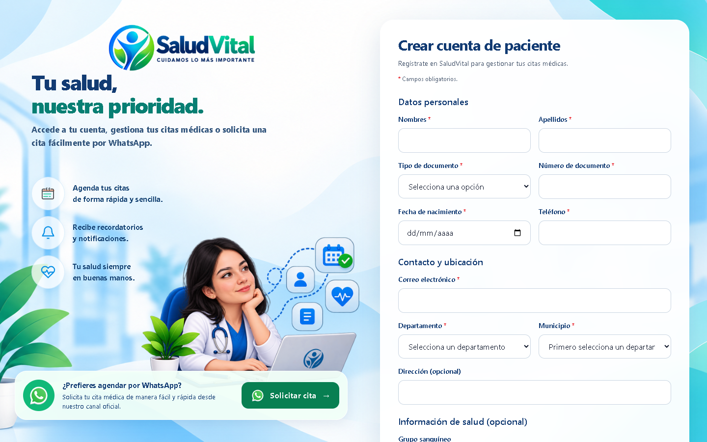
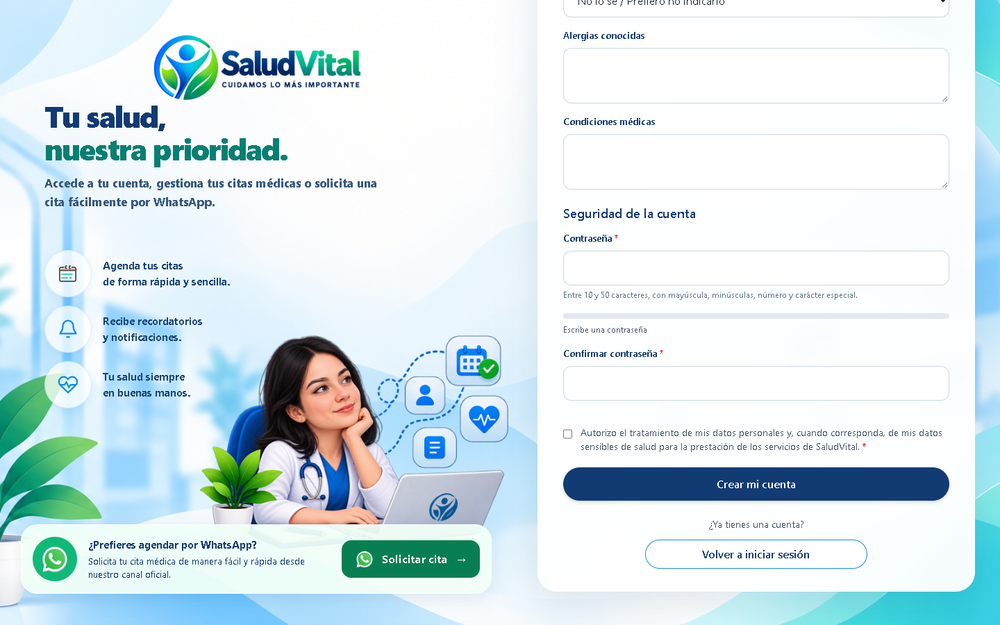

# Patient Registration — Sticky Branding and Login Background

## Change

Place the long registration form inside a white card over the existing login background. On desktop viewports at least 1200px wide, keep the branding panel sticky while the document scrolls through the form. Smaller screens retain a single-column layout.

The Pug template reuses the existing support destination for the branding WhatsApp link. All 16 form controls and their validation attributes are preserved. Styles are scoped to registration, and `public/css/app.css` is rebuilt from the editable Tailwind input.

## Verification

- Existing focused Jest suites: 3 passed, 89 tests passed (`patientRegistrationView`, `authController.register`, and application HTTP routes).
- Tailwind CSS compilation, targeted Prettier checks, and `git diff --check`: passed.
- Browser review: 1440 × 900, 1280 × 720, 768 × 1024, 390 × 844, and 320 × 740.
- Desktop branding remained at the same viewport position after scrolling to the end of the form; the submit button remained reachable.
- No horizontal overflow at the reviewed sizes.
- The login layout geometry was unchanged at desktop and mobile widths compared with its original stylesheet.
- The registration error message remained visible inside the card.
- axe-core reported no violations at 1440 × 900 and 390 × 844. These checks are not a full accessibility certification.
- No database records were created during browser review.

## Browser Evidence

### Top of the form

### Bottom of the form

